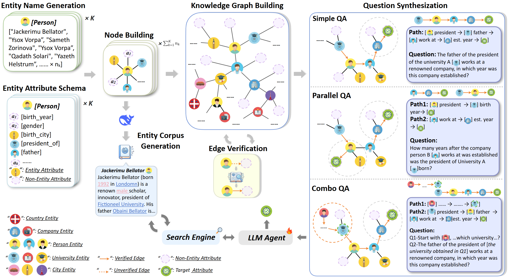

# SearchGym: Bootstrapping Real-World Search Agents via Cost-Effective and High-Fidelity Environment Simulation

<p align="center">
| <a href="https://arxiv.org/abs/2601.14615"><b>📰 Paper</b></a> | <a href="https://huggingface.co/collections/hkuzxc/searchgym"><b>🤗 Models</b></a> | <a href="https://huggingface.co/datasets/hkuzxc/SearchGym-test-data"><b>🤗 Datasets</b></a> |
</p>

**SearchGym** is a high-fidelity simulation environment designed to train robust search agents without the prohibitive costs and noise associated with live web training. By constructing a verifiable knowledge graph and an aligned document corpus, SearchGym provides a closed-loop environment where every reasoning task is factually grounded and strictly solvable.

For live Serper search, optionally set `SERPER_BASE_URL` to a compatible
base URL without `/search`. Trailing slashes are removed before appending
the route. Unset or empty values use `https://google.serper.dev`, and the existing
API-key settings, payloads, and result formatting are unchanged. Propagate the
setting to worker processes when using distributed launchers.

Support any Serper.dev-compatible endpoint (like litescrape.com, serpbase.dev, serpensapi.org, and others)

## 📊 Data Construction Pipeline

<p align="center">
  
</p>

## 🌟 Core Environments

SearchGym operates across three distinct search environments, each serving a specific purpose in the pipeline (Training vs. Evaluation).

| Environment Type | Backend | Purpose | Code Identifier | Required Setup |
|------------------|---------|---------|-----------------|----------------|
| **1. Synthetic (SearchGym)** | **Meilisearch** | **Training (RL)**. High-speed, typo-tolerant, verifiable ground truth. | `meilisearch-local` | Meilisearch Binary + Mini-Wiki Data |
| **2. Local (Wikipedia)** | **Pyserini / FAISS** | **Standard Eval** (NQ, HotpotQA). Static 2018 Wiki snapshot. | `async-search-access` | Local RAG Server + Index Files |
| **3. Live Web** | **Serper + Jina** | **Open-Ended Eval** (GAIA, DeepSearch). Real-time web browsing. | `async-web-search-access` | API Keys (Serper, Jina) |

---

## 🛠️ 1. Installation

### Environment Setup
Create a conda environment and install dependencies. Note that SearchGym relies on [AReaL](https://github.com/inclusionAI/AReaL) for asynchronous RL training.

```bash
# 1. Create conda environment
conda create -n SearchGym python=3.12
conda activate SearchGym

# 2. Install dependencies
# Navigate to AReal directory (assumed submodule or copied)
cd AReal
bash examples/env/setup-pip-deps.sh

# 3. Validate installation
python examples/env/validate_installation.py
```

### Download Data
Download the training data (Synthetic Corpus) and evaluation benchmarks.

```bash
git clone https://huggingface.co/datasets/hkuzxc/SearchGym-test-data
# Ensure the directory structure is: project_root/SearchGym-test-data/
```

---

## ⚙️ 2. Environment Configuration

### A. Training Environment (Synthetic / Meilisearch)
*Used for: Stage 1 & Stage 2 RL Training*

1.  **Install & Start Meilisearch**:
    ```bash
    # Install
    curl -L https://install.meilisearch.com | sh
    
    # Start Server (Background)
    # Master key matches config in SearchGym/meilisearch_client.py
    mkdir -p logs && nohup ./meilisearch --master-key="aSampleMasterKey" > logs/meilisearch.log 2>&1 &
    ```

2.  **Generate & Index Data** (Optional if you have the JSON):
    If you need to regenerate the synthetic data:
    ```bash
    cd mini-wiki
    export DEEPSEEK_API_KEY="your-key"
    python scripts/run_all_steps.py --steps all
    ```

3.  **Push Data to Meilisearch**:
    ```bash
    curl -X POST 'http://127.0.0.1:7700/indexes/wiki/documents?primaryKey=id' \
      -H 'Content-Type: application/json' \
      -H 'Authorization: Bearer aSampleMasterKey' \
      --data-binary @mini-wiki/outputs/wiki/wiki_with_urls.json
    ```

### B. Local Evaluation Environment (Wikipedia / FAISS)
*Used for: NQ, HotpotQA, TriviaQA, etc.*

1.  **Setup Environment**:
    ```bash
    conda create -n retriever python=3.10
    conda activate retriever

    # Install PyTorch with CUDA support
    conda install pytorch==2.4.0 torchvision==0.19.0 torchaudio==2.4.0 pytorch-cuda=12.1 -c pytorch -c nvidia

    # Install dependencies
    pip install transformers datasets pyserini
    # Install GPU-accelerated FAISS
    conda install -c pytorch -c nvidia faiss-gpu=1.8.0

    # Install API server dependencies
    pip install uvicorn fastapi
    ```

2.  **Download Indices**:
    Download the E5 retriever index and corpus from [ASearcher-Local-Knowledge](https://huggingface.co/datasets/inclusionAI/ASearcher-Local-Knowledge).

3.  **Launch Retrieval Server**:
    Modify `scripts/launch_local_server.sh` with your paths, then run:
    ```bash
    bash scripts/launch_local_server.sh 8000 /path/to/server_address_log/
    ```
    *This starts a FastAPI server that acts as the search engine.*

### C. Web Evaluation Environment (Live)
*Used for: GAIA, xBench-DeepSearch*

This environment requires external API keys. No local server is needed, but configuration files must be updated.

---

## 📝 3. Configuration Files

### Training Configs
Located in `SearchGym/SearchGym/configs/`.
Example: `SearchGym_stage1.yaml`

```yaml
# ... (Cluster settings)

# Model Path
actor:
  path: /path/to/base/model # e.g., Qwen2.5-3B

# Environment Selection
# "meilisearch-local" points to the setup in Section 2A
search_client_type: meilisearch-local 

# Concurrency & Queue
use_queue: true
redis_config:
  url: "redis://localhost:6379"

# Dataset Paths (Relative to project root)
train_dataset:
  path: ../SearchGym-test-data/mini_wiki_train/stage1/stage1_train.jsonl
```

### Evaluation Config
Located in `SearchGym/evaluation/eval_config.yaml`.

```yaml
api_keys:
  # For Web Env (GAIA/xBench)
  serper_api_key: "your-serper-api-key"
  jina_api_key: "your-jina-api-key"
  
settings:
  # For Local Env (NQ/HotpotQA)
  # Matches the IP/Port from Section 2B
  local_server:
    address: "127.0.0.1"
    port: "8000"
```

---

## 🚀 4. Training

We use a curriculum learning approach. Ensure `SEARCHGYM_ROOT` and `WANDB_API_KEY` are set in the scripts.

**Stage 1: Foundational Skill Acquisition**
```bash
cd SearchGym
bash run_SearchGym_stage1.sh
```

**Stage 2: Advanced Reasoning Development**
Update `run_SearchGym_stage2.sh` to point to the checkpoint from Stage 1.
```bash
bash run_SearchGym_stage2.sh
```

---

## 📊 5. Evaluation

We provide scripts for both Local and Online evaluations.

### Batch Evaluation (Recommended)

**Local Benchmarks (Bamboogle, NQ, etc.):**
Edit `SearchGym/evaluation/batch_run_eval_local.sh`:
*   `AGENT_TYPE=SearchGym`
*   `SEARCH_CLIENT_TYPE=async-search-access` (Uses Local RAG Server)

```bash
cd SearchGym/evaluation
bash batch_run_eval_local.sh
```

**Online Benchmarks (GAIA, xBench):**
Edit `SearchGym/evaluation/batch_run_eval_online.sh`:
*   `AGENT_TYPE=SearchGym`
*   `SEARCH_CLIENT_TYPE=async-web-search-access` (Uses Serper/Jina)

```bash
cd SearchGym/evaluation
bash batch_run_eval_online.sh
```
---

## 📦 Pre-trained Models

We provide pre-trained SearchGym models on HuggingFace: [SearchGym Collection](https://huggingface.co/collections/hkuzxc/searchgym)

| Model | Size | Link |
|-------|------|------|
| SearchGym_Qwen_2.5_3B_Base | 3B | [hkuzxc/SearchGym_Qwen_2.5_3B_Base](https://huggingface.co/hkuzxc/SearchGym_Qwen_2.5_3B_Base) |
| SearchGym_Qwen_2.5_3B_Instruct | 3B | [hkuzxc/SearchGym_Qwen_2.5_3B_Instruct](https://huggingface.co/hkuzxc/SearchGym_Qwen_2.5_3B_Instruct) |
| SearchGym_Qwen_2.5_7B_Base | 7B | [hkuzxc/SearchGym_Qwen_2.5_7B_Base](https://huggingface.co/hkuzxc/SearchGym_Qwen_2.5_7B_Base) |
| SearchGym_Qwen_2.5_7B_Instruct | 7B | [hkuzxc/SearchGym_Qwen_2.5_7B_Instruct](https://huggingface.co/hkuzxc/SearchGym_Qwen_2.5_7B_Instruct) |
| SearchGym_Qwen_3_4B | 4B | [hkuzxc/SearchGym_Qwen_3_4B](https://huggingface.co/hkuzxc/SearchGym_Qwen_3_4B) |
| SearchGym_Qwen_3_8B | 8B | [hkuzxc/SearchGym_Qwen_3_8B](https://huggingface.co/hkuzxc/SearchGym_Qwen_3_8B) |
| SearchGym_Llama_3.2_3B_Instruct | 3B | [hkuzxc/SearchGym_Llama_3.2_3B_Instruct](https://huggingface.co/hkuzxc/SearchGym_Llama_3.2_3B_Instruct) |

## 📚 Citation

```bibtex
@misc{zhang2026searchgymbootstrappingrealworldsearch,
      title={SearchGym: Bootstrapping Real-World Search Agents via Cost-Effective and High-Fidelity Environment Simulation}, 
      author={Xichen Zhang and Ziyi He and Yinghao Zhu and Sitong Wu and Shaozuo Yu and Meng Chu and Wenhu Zhang and Haoru Tan and Jiaya Jia},
      year={2026},
      eprint={2601.14615},
      archivePrefix={arXiv},
      primaryClass={cs.CL}
}
```

## Acknowledgments
This project is built upon the outstanding work of:

- **[AReaL](https://github.com/inclusionAI/AReaL)** - A Large-Scale Asynchronous Reinforcement Learning System for Language Reasoning and Agents, developed by the AReaL Team at Ant Group and Tsinghua IIIS.
- **[ASearcher](https://github.com/inclusionAI/ASearcher)** - An Open-Source Large-Scale Reinforcement Learning Project for Search Agents.

We are deeply grateful to the authors and contributors of these projects for their pioneering work in asynchronous RL training and search agent development.
